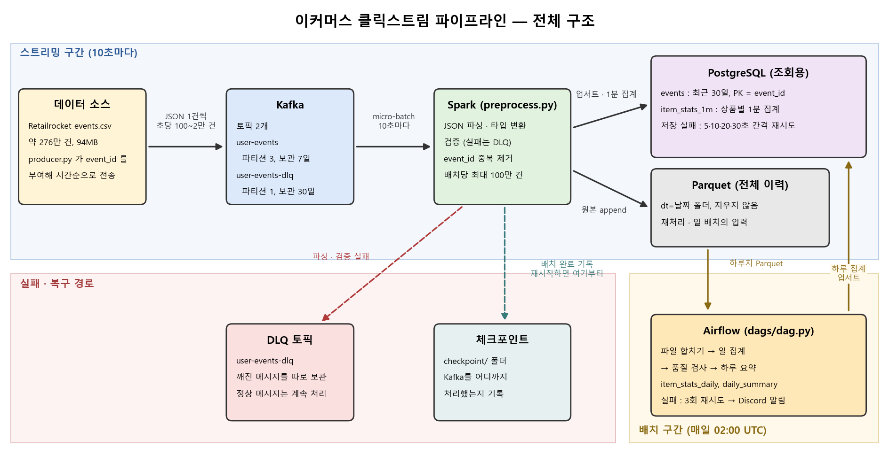

# Real-Time E-commerce Clickstream Pipeline

## 0. Summary
이 프로젝트는 쇼핑물 클릭로그를 1분단위로 집계하는 파이프라인입니다.
로컬 6 코어 환경에서 돌렸고 초당 13000건 이었던 처리량을 2만건으로 개선하고 SPARK와 DB가 정지하더라도 유실이나 중복이 없도록 설계를 하였습니다.


## 1. Problem & Data

**데이터**

| 항목 | 내용 |
|---|---|
| 출처 | [Retailrocket recommender system dataset](https://www.kaggle.com/datasets/retailrocket/ecommerce-dataset) 의 `events.csv` (94MB) |
| 기간 | 2015-05-03 ~ 2015-09-18, 139일 |
| 건수 |  276만 건. 하루 평균  2만 건, 가장 많은 날 약 3만 3천 건, 가장 많은 1분 87건 |
| 이벤트 종류 | 조회 약 266만 건 (96.7%) · 장바구니 약 69,000건 (2.5%) · 구매 약 22,000건 (0.8%) |
| 유저 · 상품 | 유저 약 140만 명, 상품 약 23만 개 |
| 입력 방법 | `producer.py` 가 CSV를 시간순으로 다시 보낸다. 초당 건수를 정할 수 있어서 같은 데이터로 로드 테스트를 진행한다 |

| 필드 | 타입 | 뜻 |
|---|---|---|
| `timestamp` | int64 | 발생 시각 (ms) |
| `visitorid` | int64 | 유저 |
| `event` | string | `view` / `addtocart` / `transaction` |
| `itemid` | int64 | 상품 |
| `transactionid` | int64, null | 구매일 때만 값이 있음 |

```csv
timestamp,visitorid,event,itemid,transactionid
1433221332117,257597,view,355908,
1433222276276,599528,transaction,356475,4000
```

쇼핑몰 운영자가 현재 어떤 상품이 조회 . 구매 되는지를 볼 수 있게 하는 것이 목표다. 운영자는 1분 단위 집계와 하루 단위 요약을 본다.

**문제점**

- 이벤트가 중복되거나 깨져서 들어올 수 있다.
- 처리 도중에 Spark나 DB가 멈출 수 있다.


## 2. Architecture




## 3. Design Decisions

**결정 1. 4 개의  컬럼을 합쳐 해시로 만든 `event_id` 를 기본키로 쓴다**

원본 데이터에서 행을 구분하려면 `timestamp`, `visitorid`, `event`, `itemid` 4개의 컬럼을 합쳐 기본키로 써야 했다. 이는 불편하다고 판단하여 기본키로 사용할 컬럼을 새로 만들기로 했다.

처음에는 uuid.uuid4() 를 event_id 값으로 하였는데 이방식은 서로 다르지만 중복을 거를수가 없었다. 예를들어 동일한 데이터가 2번 들어올떄 첫번쨰 데이터에 랜덤 id 가 부여되고 또 2번쨰들어온것에도 랜덤 id가 부여되면 둘다 다른 데이터로 취급이 되는 문제가 있다


그래서 네 컬럼의 값을 이어 붙이고, 그 문자열을 해시해서 `event_id` 를 만들었다. 같은 행은 몇 번을 보내도 항상 같은 `event_id` 가 나온다.

```python
전 event_id = uuid.uuid4()

후 event_id = uuid.uuid5(uuid.NAMESPACE_OID, f"{timestamp}|{visitorid}|{event}|{itemid}")
```


하지만 해시를 계산해야 해서 ID 하나를 만드는 시간이 랜덤 방식의 약 2배다. 


**결정 2. 전체 데이터는 Parquet에,  PostgreSQL에는 최근 30일만 둔다**

처음에는 PostgreSQL 하나에 모든 이벤트를 저장하려 했다. 저장하는 곳이 하나면 구조가 단순하고 편할거라고 생각했다.

그런데 이벤트를 계속 쌓으면 DB의 저장과 조회가 느려지며 parquet처럼 용량이 적은것도 아니다. 그리고 DB 에만 저장시 집계에 문제가 있었으면 원상 복구가 불가능하다.

그래서 저장하는 곳을 둘로 나눴다. Spark가 배치마다 같은 이벤트를 Parquet과 PostgreSQL 두 곳에 쓴다. Parquet에는 모든 데이터를 저장. PostgreS 에는 가장 최근 이벤트 기준 30일까지만 둔다.


단점은 30일보다 오래된 이벤트를 PostgreSQL에서 바로 조회할 수 없다는 것이다. 그때는 Parquet을 직접 읽거나 사용자가 db로 직접 옮겨야 한다.

**결정 3. 토픽을 정상, 실패 2개로 나누고, 정상은 파티션을 3개로 둔다**

구조를 이와 같이 한 이유는 

첫째, 깨진 메시지가 정상 메시지와 섞여 들어올 수 있다. 토픽이 하나면 깨진 메시지를 버릴 수밖에 없어서, 나중에 확인하거나 다시 처리할 수 없다. 둘째, 로드 테스트에서는 초당 2만 건까지 보낸다. 파티션이 1개로는 힘들거같아 3개로 결정하였다.

정상 토픽 `user-events` 는 파티션 3개, 보관 7일로 만들었다. 실패 토픽 `user-events-dlq` 는 파티션 1개, 보관 30일로 만들었다. Spark는 파싱이나 검증에 실패한 메시지를 실패 토픽으로 보내고, 정상 메시지는 계속 처리한다.

이렇게 하면 깨진 메시지가 30일 동안 남아 있어서 원인을 확인할 수 있다. 

단점은 이벤트를 읽는 순서가 같은 파티션 안에서만 지켜진다는 것이다.  서로 다른 파티션에 있는 유저는 순서가 섞일 수 있다.

## 4. Reliability

**검증 1. 재실행**

해결 방법

 데이터를 집어넣을떄 ON CONFLICT(기본키) DO NOTHING 

결과

| 항목 | 값 |
|---|---|
| 실험 | 체크포인트를 지우고 같은 23,000건을 다시 처리했다 |
| 새로 저장된 건수 | 0건 |
| 이미 있어서 건너뛴 건수 | 23,000건 |
| 1분 집계 | 처음과 동일  |

**검증 2. Spark 강제 종료**

해결 방법


Spark 가 처리중 죽으면 처리중이던게 날라가고 처음부터 다시 처리를 해야한다. 
처음부터 다시 처리를 하여도 중복은 발생하지않지만 시간이 손실만큼 소모된다.
이를 방지하기위해 Spark -> DB 저장이 끝나면 체크포인트를 적어 도중에 죽어도 이어서 할 수 있게끔 처리했다.


결과

| 항목 | 값 |
|---|---|
| 실험 | 초당 1,000건을 보내는 도중에 Spark를 종료하고 15초 뒤에 다시 켰다 |
| 보낸 건수 | 120,000건 |
| 저장된 건수 | 119,987건 (차이 13건은 원본 CSV에 있던 중복 행) |
| 유실 / 중복 | 0건 / 0건 |
| 꺼져 있는 동안 밀린 건수 | 39,501건. 다시 켜진 Spark가 4.5초 만에 처리했다 |
| 복구 시간 | 다시 켜고 29초 뒤에 지연이 평소 수준으로 돌아왔다 |

**검증 3. DB 1분 정지**

해결 방법

DB가 멈추면 저장이 실패하고, 그대로 두면 Spark도 같이 죽는다. 그래서 저장에 실패해도 Spark가 죽지 않고 5 · 10 · 20 · 30초 간격으로 다시 시도하게끔 설계를 바꿨다.

DB가 멈춘 동안 들어온 메시지는 Kafka에 남아 있다. 그래서 DB가 다시 켜지면 Spark가 밀린 메시지를 이어서 처리한다.

결과

| 항목 | 값 |
|---|---|
| 실험 | 초당 1,000건을 보내는 도중에 PostgreSQL을 60초 동안 멈췄다 |
| 보낸 건수 | 150,000건 |
| 저장된 건수 | 149,970건 (차이 30건은 원본 CSV에 있던 중복 행) |
| 유실 / 중복 | 0건 / 0건 |
| Spark의 저장 재시도 | 4번. DB를 켜고 8초 뒤에 저장에 성공했다 |
| 멈춘 동안 밀린 건수 | 77,061건. Spark가 8.7초 만에 처리했다 |
| 복구 시간 | DB를 켜고 24초 뒤에 지연이 평소 수준으로 돌아왔다 |


## 5. Load Test

**측정 환경**

| 항목 | 사양 |
|---|---|
| CPU · 메모리 | AMD Ryzen 5 5600X · 32GB |
| 저장장치 | Samsung SSD 970 EVO Plus 500GB |
| Kafka · PostgreSQL | Docker Desktop 컨테이너 |
| Spark | `local[*]`, `spark.sql.shuffle.partitions` = 8, trigger 10초 |
| 부하 | 단계마다 2분. 실제로 보낸 속도는 producer 로그로 확인했다 |

**개선 전**

| 입력 (건/s) | 배치 시간 평균 / 최대 | 지연 p95 | lag 최대 · 추세 | 판단 |
|---|---|---|---|---|
| 100 | 1.9s / 5.5s | **10.7s** | **734 · 일정** | 여유 |
| 300 | 2.0s / 2.2s | **10.5s** | **1,330 · 일정** | 여유 |
| 1,000 | 6.4s / 7.0s | **10.8s** | **7,879 · 일정** | 여유 |
| 3,000 | 4.1s / 9.0s | **11.6s** | **16,804 · 일정** | 여유 |
| 6,000 | 6.0s / 11.1s | **12.2s** | **76,416 · 일정** | 여유 |
| 10,000 | 7.2s / 7.9s | **14.3s** | **64,966 · 일정** | 여유 |
| 20,000 | 40.5s / 63.0s | **44.3s** | **1,048,636 · 계속 증가** | **한계** |

초당 2만 건에서는 처리 속도가 입력 속도를 따라잡지 못해 lag가 계속 쌓였다. lag가 쌓이면 이벤트가 처리될 때까지 기다리는 시간이 길어진다. 그래서 지연 p95도 14.3초에서 44.3초로 늘었다.

**병목**

| 구간 | 시간 | 비율 | 원인 |
|---|---|---|---|
| Spark 파싱 · 검증 · 중복 제거 | 34.0s | 57% | Spark가 같은 JSON을 3번 파싱한다. 불량 메시지를 셀 때, 정상 메시지를 셀 때, 중복을 제거할 때 매번 처음부터 다시 파싱한다 |
| PostgreSQL 저장 | 22.6s | 38% | `events` 에 넣는 데 12.0초. 행마다 인덱스도 같이 갱신한다 |
| Parquet 저장 | 2.9s | 5% | |

**변경점**

개선 전

```python
parsed = parse(raw)                     # 여기서는 파싱하지 않고, 쓸 때 파싱함
bad, good = validate(parsed)

n_bad = bad.count()                     # 파싱 1
bad.write.format('kafka')...save()      # 파싱 2
n_good = good.count()                   # 파싱 3
dedup = good.dropDuplicates(['event_id']).cache()
n_dedup = dedup.count()                 # 파싱 4
```

개선 후

```python
parsed = parse(raw).cache()             # 파싱 결과를 캐시
bad, good = validate(parsed)

bad.write.format('kafka')...save()      # 이때 파싱 1번 → df 캐시에 저장
n = good.count()                        # 캐시된 df 사용, 파싱 안 함
good.write.parquet(...)                 # 캐시된 good 사용
save_retry(good)                        # 캐시된 good 사용
```

**개선 후**

| 초당 2만 건 | 개선 전 | 개선 후 |
|---|---|---|
| 배치 시간 평균 / 최대 | 40.5s / 63.0s | 10.1s / 13.7s |
| 지연 p95 | **44.3s** | **13.9s** |
| lag 최대 | **1,048,636** | **243,869** |
| Spark 구간 (건당) | 32.4µs · 57% | 10.3µs · 21% |
| PostgreSQL 구간 (건당) | 21.5µs · 38% | 35.5µs · 72% |
| 배치 하나 전체 (건당) | 56.7µs | 49.1µs |

## 6. How to Run

```
repo/
├─ docker-compose.yml           Kafka · PostgreSQL
├─ docker-compose.airflow.yml   Airflow
├─ create_topics.py             토픽 생성
├─ producer.py                  events.csv → Kafka
├─ consumer.py                  확인용 consumer
├─ preprocess.py                Spark 전처리 · 저장
├─ dags/dag.py                  Airflow 일 배치
├─ loadtest/                    로드 테스트 스크립트
├─ schema.sql                   PostgreSQL 스키마
└─ data/events.csv              Kaggle 에서 받아서 넣는다 (git 제외)
```

Python 3.10, Java 21에서 실행했다.

**수집 · 처리**

```bash
pip install -r requirements.txt
docker compose up -d
python create_topics.py
python preprocess.py
python producer.py --rate 500 --limit 30000
```

**일 배치** — Airflow UI는 `localhost:8080` (airflow / airflow)

```bash
docker compose -f docker-compose.yml -f docker-compose.airflow.yml up -d
docker exec airflow-scheduler airflow dags unpause daily_events
docker exec airflow-scheduler airflow dags trigger daily_events -c '{"target_date": "2015-06-10"}'
docker exec airflow-scheduler airflow dags backfill daily_events -s 2015-05-03 -e 2015-06-18
```

**로드 테스트 · 장애 실험** — `preprocess.py` 를 켜 둔 상태에서

```bash
bash loadtest/run_steps.sh 0 6000
bash loadtest/run_steps.sh 0 20000
python loadtest/report.py --drain-seconds 60
bash loadtest/run_failure_db.sh 2400000
bash loadtest/run_failure_spark.sh 2550000
```

**`preprocess.py` 에 고정된 값**

| 항목 | 값 |
|---|---|
| trigger | 10초 |
| 배치 최대 크기 | 100만 건 |
| Parquet 경로 | `data/parquet/loadtest` |
| 체크포인트 경로 | `checkpoint/loadtest` |
| 측정 기록 | `data/metrics/progress.jsonl`, `data/metrics/batches.jsonl` |

지금 값은 로드 테스트용이다. Airflow는 `data/parquet/events` 를 읽으므로, 일 배치까지 이어서 돌릴 때는 Parquet 경로를 `data/parquet/events` 로 바꾼다.

## 7. Retrospective & Next Steps

**다시 한다면**

- 여러 번 쓰는 결과는 캐시하는 습관을 들이겠다. Spark는 결과를 쓸 때마다 계산을 처음부터 다시 한다
- 실행 설정을 코드에 고정하지 않고 옵션으로 받아서, 좀 더 유연하게 실행할 수 있게 하겠다

**실제 운영이라면**

- 대량 적재와 조회를 서로 다른 DB로 분리하겠다. 지금은 Spark가 10초마다 수십만 건을 넣는 DB에서 조회도 한다
- 지연 · lag · DLQ 비율 기준의 알림을 스트리밍에도 연결하겠다. 지금은 알림이 일 배치에만 있다
